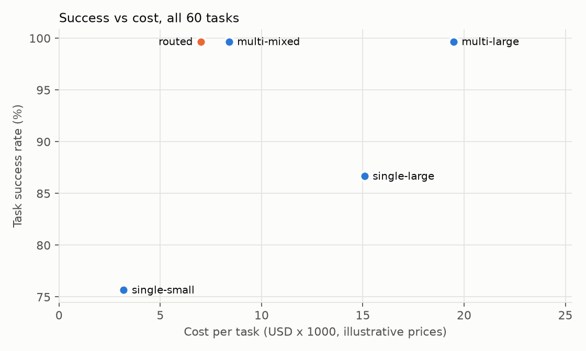
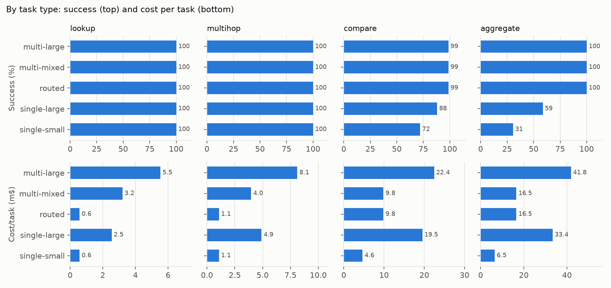
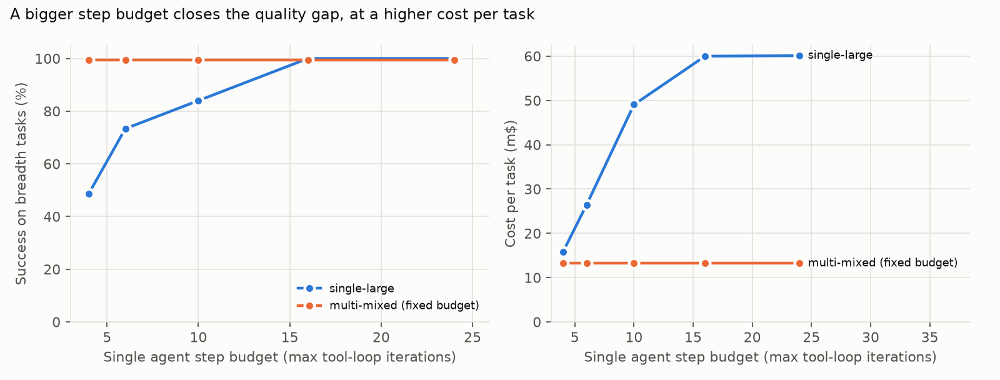
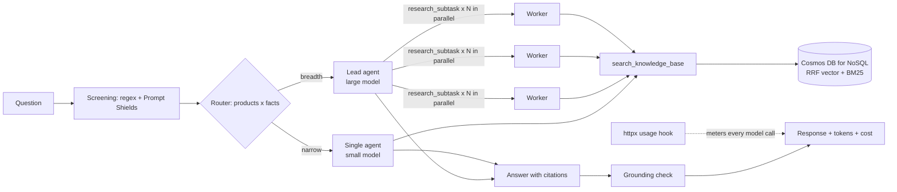

# Single-Agent vs Multi-Agent Evaluation

Is an orchestrator-worker agent system worth the extra cost? This service runs the same
questions through a single agent and through a lead agent that delegates to parallel workers,
grades every answer against ground truth, meters every token, and turns the result into a
decision: which architecture to use for which request, and at what value per answer the more
expensive one pays for itself. It also ships the decision as a production API with a router.

Built on **Microsoft Agent Framework**, **Azure OpenAI**, **Azure Cosmos DB for NoSQL** (vector
plus full-text hybrid search), **Azure AI Content Safety**, **FastAPI** on **Azure Container
Apps**, with **OpenTelemetry** to Azure Monitor, **Prometheus** metrics, **Bicep** and **GitHub
Actions** (OIDC).

## Results (offline simulator, 1,500 graded runs: 60 tasks x 5 architectures x 5 seeds)

| Architecture | Success (95% CI) | Cost per task | vs single-large | Latency p50 |
|---|---|---|---|---|
| single-small | 75.7% (71 to 80) | $0.0032 | 0.21x | 3.2 s |
| single-large | 86.7% (82 to 90) | $0.0151 | 1.00x | 6.6 s |
| multi-large | 99.7% (98 to 100) | $0.0195 | 1.29x | 10.3 s |
| multi-mixed (large lead, small workers) | 99.7% (98 to 100) | $0.0084 | 0.56x | 7.8 s |
| **routed** (small single for narrow, multi-mixed for breadth) | **99.7%** (98 to 100) | **$0.0070** | **0.46x** | **5.5 s** |

* On **breadth** tasks (scan 12 products), orchestrator-worker lifts success from **59% to
  100%**. On **lookups** it buys nothing and multi-large costs **2.2x** as much.
* A single agent can match multi-agent quality on breadth tasks, but only with a 16-step budget,
  at **4.5x** the cost per task and a 70% higher median latency.
* The router keeps multi-agent quality at **54% lower cost** than the single large agent and
  **64% lower** than always using multi-agent.





Prices are illustrative placeholders (large 2.00/8.00, small 0.40/1.60 USD per 1M input/output
tokens). The simulator's assumptions and their sensitivity are in
[docs/methodology.md](docs/methodology.md). Run `live-eval` to measure real Azure OpenAI models.

## How it works



* `agents/system.py`: both architectures on Agent Framework. The lead's `research_subtask` tool
  starts a fresh worker agent per call; Agent Framework runs the lead's parallel tool calls
  concurrently. Budgets via `max_iterations`; long single-agent histories are compacted by
  `ContextWindowCompactionStrategy`.
* `llm/clients.py` + `llm/ledger.py`: an httpx hook on the OpenAI client records tokens, tier
  and latency of every call into a per-task ledger (context variables keep concurrent runs
  apart). Same accounting for the simulator and Azure.
* `llm/sim.py`: an OpenAI-compatible simulator for offline, zero-cost, reproducible runs.
* `evaluation/`: tasks with ground truth, a deterministic grader (correct **and** grounded),
  the runner, economics (Wilson intervals, cost per success, break-even value) and the
  sensitivity sweep.
* `api/app.py`: `POST /v1/ask` with `mode` = auto, single, multi or an architecture name.

## Quickstart (offline, no keys)

```bash
python -m venv .venv && . .venv/bin/activate
pip install -e ".[dev,eval]"
make test                 # 38 tests, 95% coverage
archeval ask "Which Contoso products have an uptime SLA of 99.95% and store data in India Central?"
make bench                # writes reports/latest/{report.md,summary.json,*.png}
make gate                 # CI gate: routed success >= 95% and cost <= 0.75x single-large
make serve                # http://localhost:8000/docs
docker compose up --build # API + Prometheus with cost and groundedness alerts
```

## On Azure

```bash
az group create -n rg-archeval -l eastus2
az deployment group create -g rg-archeval -f infra/main.bicep -p infra/main.bicepparam
# then the deploy workflow builds the image in ACR and rolls it out; or run it locally:
ARCHEVAL_LLM_PROVIDER=azure ARCHEVAL_AZURE_OPENAI_ENDPOINT=... archeval bench --repeats 1
```

All services use the container app's managed identity. Keys are disabled on Azure OpenAI,
Content Safety and Cosmos DB. GitHub Actions signs in to Azure with OIDC, no stored secret.

## Configuration

All settings are environment variables with the `ARCHEVAL_` prefix; see `.env.example`.
Budgets: `ARCHEVAL_LIMITS__SINGLE_MAX_ITERATIONS`, `..._WORKER_MAX_ITERATIONS`,
`..._LEAD_MAX_ITERATIONS`, `..._MAX_WORKERS`. Prices: `ARCHEVAL_PRICES` (JSON).

## Responsible AI and operations

* Input screening (heuristics, then Azure AI Content Safety Prompt Shields when configured).
* Retrieved text is treated as data; override phrases are neutralised before reaching a model.
* Every answer is checked for unknown or missing citations; ungrounded answers are counted and
  alerted on.
* Questions are redacted (emails, phone numbers) before logging. Agent Framework traces are
  exported without prompt text.
* Prometheus alerts: cost per answer, ungrounded rate, and a sudden jump in the multi-agent
  share of traffic.

## Repository map

```
src/archeval/  agents/ api/ corpus/ evaluation/ llm/ retrieval/ safety/ cli.py telemetry.py
tests/         38 tests (agents, API, evaluation, retrieval incl. a fake Cosmos client, sim)
infra/         main.bicep (Container Apps, Azure OpenAI, Cosmos DB, Content Safety, monitoring)
.github/       CI, benchmark gate, OIDC deploy, live eval, Copilot instructions
deploy/        Prometheus config and alert rules
docs/          methodology and assumptions
reports/latest benchmark output
```
